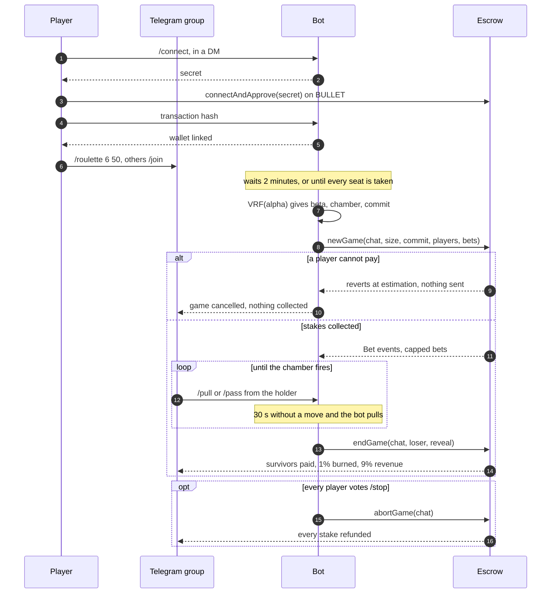

# zvm-bullet guide

[Bullet Game](https://bullet-game.gitbook.io/bullet-game), Russian Roulette in
Telegram for the `BULLET` token, on the ZVM. The token and the escrow are the
contracts the game ran on Ethereum, pulled from mainnet; the bot is new, written
to the original's documented rules because its source was never published.

- `contracts/`: the mainnet sources, the ZVM port, and the scripts that build
  and check them
- `cmd/zvm-bullet`: `keys`, `deploy`, `check`, `bot` and `verify`
- `web/`: the page at a ZVM gateway's `/bullet/`, the gitbook's
  equivalent
- `deployments/zvm.json`: what a deploy wrote; kept out of git, as every devnet deploys its own

| | First deployment (chain 7340469) |
|---|---|
| BULLET | `0xEf9282a0512a52091B6b1cB6AC4Aec5FE4d7dfCB` |
| Escrow | `0xDA650bF1788488f5533BF8c822a3F80dDd70413b` |
| BULLET / wrapped ZNN pair | `0x06F8e601ef6074c6cFFc95d7aF410BAf61f27F21` |
| Bot, dev wallet | `0x2Ce6EA2DA2C289afC7274b2f8623D32B5aE3083b` |

Both contracts are verified on the explorer with an exact match.

## The contracts, and what changed

`contracts/mainnet/` holds the verified source of
[BulletGame](https://etherscan.io/address/0x8ef32a03784c8Fd63bBf027251b9620865bD54B6)
and [TelegramRussianRoulette](https://etherscan.io/address/0x4d2E8a0ebC4BB3BE7F3d65426F6a0C5836635DBE)
as Blockscout serves it, and `mainnet.json` the settings and the creation
bytecode Ethereum ran. `npm run check:mainnet` compiles the sources with those
settings (solc 0.8.19, 1,000,000 runs, paris) and compares: every executable
byte is identical. The metadata hash differs, as it does in Sourcify's and
Blockscout's own records of both, which are partial matches too: it hashes the
author's exact file, and that file was never published.

On the ZVM:

- **The escrow is unchanged.** It is deployed from `mainnet/`, and
  `npm run build` refuses to produce it if its code ever stops matching
  mainnet's. Constructor arguments are mainnet's: a minimum bet of 1,000 base
  units, 9% of the loser's stake to revenue, 1% burned.
- **The token has one added constructor branch** (`contracts/zvm/`, a
  four-line diff): on chain 7340469 its router is Glyphswap's Uniswap V2
  router. Mainnet's constructor refuses every chain but Ethereum and its
  testnets, so the unmodified token cannot be deployed here at all.

"ETH" in both is the chain's coin, ZNN, and WETH is wrapped ZNN.

`zvm-bullet deploy` replays mainnet's launch, read off its deployer's
transactions from 2023-08-02: deploy both, `setMyWallet`,
`setRouletteContract`, `setMarketingWallet`, `setRevenueWallet`,
`enableAntiBotMode`, `stealthLaunch` (2.5 ETH there, 250 ZNN here),
`disableAntiBotMode`, `renounceOwnership`. Each step checks the chain first and
is skipped if it has happened, so a deploy that stops is finished by running it
again. The renounce cannot be undone, so it only goes out after `check` passes:
every address, flag, tax rate, supply split and the pool's reserves read back
from the chain. Everything it spends comes from the devnet wallet, zvm's dev
EVM key 900.

## A game



The rules are the original's: one game per group; at most as many players as
chambers; the holder must pull at least once before passing; an AFK holder is
pulled for until they return or die; a unanimous `/stop` refunds everyone; the
escrow caps each bet at the sum of the others' so nobody loses more than the
table can pay. Where the docs are silent the bot decides: the join window (2
minutes, `-join-window`), the AFK timeout (30 s, `-afk`), the largest revolver
(12, `-max-size`), and that whoever opens a game joins it at the minimum.

The bot's own addresses (bot, marketing, revenue, token, escrow, pair) can never
join a game: the bot knows the chamber from the moment it starts. After a
restart, a game the escrow still holds is aborted and refunded, as mainnet's
operator did after a crash; a table cannot be resumed honestly once its turn
clock is gone.

## Provably fair

As the original docs describe, with the encoding they left open pinned down in
`internal/fair`:

```
alpha   = "<unix seconds>.<microseconds>,[bet1, bet2, ...]"   bets in base units, join order
beta    = VRF(alpha)                                          64 bytes
chamber = beta mod size                                       beta read big-endian
commit  = SHA-256(ASCII(decimal(chamber)) || ASCII(salt))     salt: 16 random bytes as 32 hex characters
```

`endGame` carries `beta`, `salt`, `publickey`, `proof` and `alpha`, labelled as
mainnet's were. `zvm-bullet verify -record deployments/zvm.json <endGame tx>`
finds the game's `newGame` from the escrow's `Bet` events and checks all of it
from chain data, nothing from the bot.

The VRF is ECVRF-EDWARDS25519-SHA512-TAI from RFC 9381, tested against the
RFC's three vectors. The original named Algorand's library, which is the ELL2
suite from draft 03: the same proof and output sizes, with Elligator2 for
hashing to the curve. The bot chooses the moment in `alpha` and holds the key,
so it could grind timestamps before committing; the commitment only stops the
chamber moving once play starts. Mainnet had the same property, and the page
says so.

## Running it

```sh
cd contracts && npm install && npm run check:mainnet && npm run build
go test ./...
zvm-bullet keys -out secrets/bullet.json      # refuses to overwrite
zvm-bullet deploy -keys secrets/bullet.json -record deployments/zvm.json
zvm-bullet check -record deployments/zvm.json
```

Bullet Game deploys on its own, from this directory, and nothing of it lives
in any other repository. `docker-compose.yml` runs two services:

- `bot`: the Telegram bot. It reaches chain 69 through the JSON-RPC `.env` names
  (`ZVM_RPC`; no node is built in), as any outside client does.
- `web`: the page at the gateway's `/bullet/`, built and served by Caddy on
  `127.0.0.1:47601`. The devnet's gateway forwards `/bullet/*` to it and holds nothing
  else of Bullet's.

Every setting is in `.env` (copy `.env.example`): the Telegram token, chats and
admins, the bot's username for the page, the RPC, file paths and game timings.
The bot reads all of it from its environment, so its command is just `bot`;
flags still override it for a run by hand. `secrets/bullet.json` is the
escrow's owner, whoever holds it can stake any connected player's BULLET, so it
is random and secret. `.env` and `secrets/` are kept out of git and out of both
images; the page image gets only `VITE_BULLET_BOT`, the one value it shows.

```sh
docker compose up -d --build     # after any change to .env or the code
docker compose logs -f bot
```

`docker restart` would keep the environment the container was created with, so
a change to `.env` needs `up -d`. Recreating the bot aborts and refunds any game
the escrow still holds (see above). Only one process may poll a bot token, so
`zcribe bot` cannot run while this uses `@zcribe_bot`'s.

Live tests, which spend devnet ZNN from the dev wallet, run against the fork
first and chain 69 after; set `BULLET_LIVE_RPC`, `BULLET_LIVE_RECORD` and
`BULLET_LIVE_KEYS` (absolute paths):

- `go test ./internal/escrow -run Live`: players buy through the router and
  connect; a game with a capped bet pays winnings, burn and revenue to the base
  unit; an abort refunds at par; a revoked approval is caught before sending.
- `go test ./internal/game -run Live`: the same through the real engine; with
  `BULLET_LIVE_TG_CHAT` and `BULLET_TELEGRAM_TOKEN` every message also goes to
  Telegram, which is how the HTML was checked against its parser.

A launch can be rehearsed on an anvil fork of chain 69, which keeps chain id
7340469 and the real router, so the pair it creates never reaches Glyphswap:

```sh
docker run -d -p 127.0.0.1:48645:8545 --add-host=host.docker.internal:host-gateway \
  ghcr.io/foundry-rs/foundry:latest \
  "anvil --host 0.0.0.0 --fork-url $ZVM_RPC --chain-id 7340469 --block-time 2"
zvm-bullet deploy -rpc http://127.0.0.1:48645 -api "" -keys <throwaway keys> -record <throwaway record>
```

## Trading BULLET

BULLET taxes transfers into and out of its pair, 5% each way. Uniswap V2's plain
swap functions cannot sell such a token (the pair receives less than it was
told, and its K check reverts) and quote buys 5% high, so Glyphswap now reads a
token's `buyTaxBps`/`sellTaxBps`, quotes after the tax, and uses the router's
fee-on-transfer functions for it, including `removeLiquidityETH`'s.
`zvm-glyphswap/scripts/verify-taxed.mjs` buys and sells BULLET through the
real card in headless Chrome and checks the quote against what arrived.
